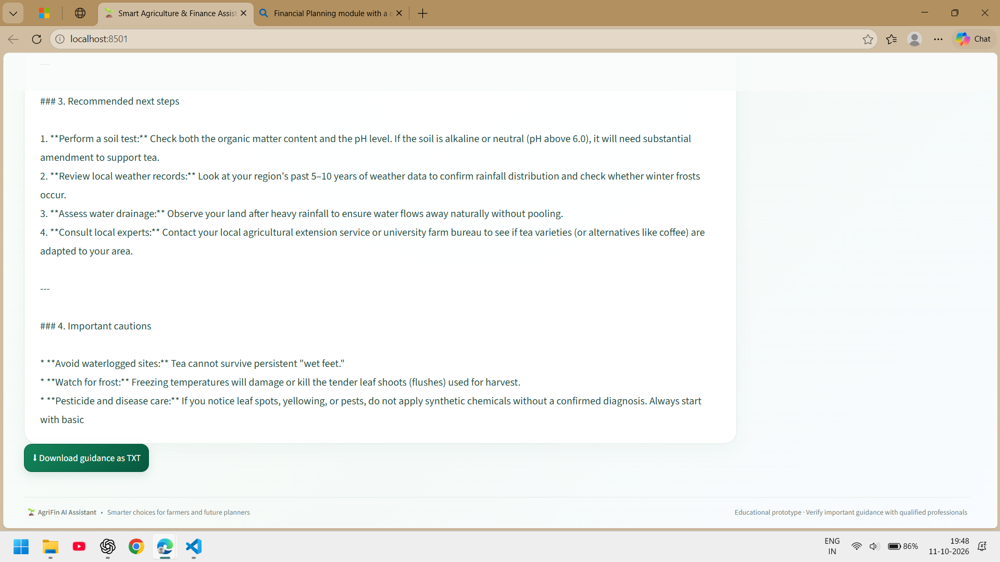
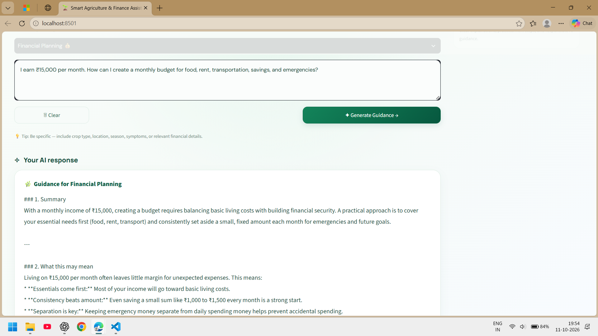
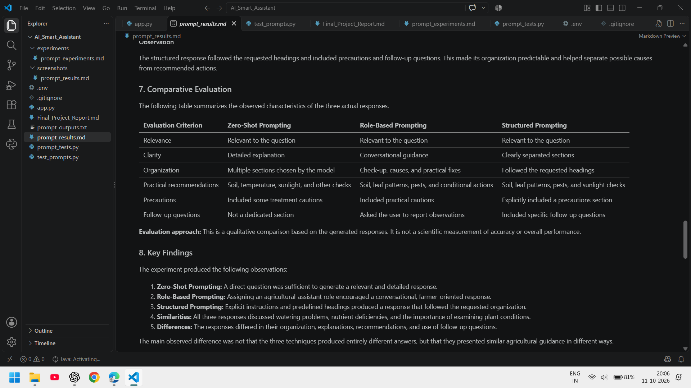

# AgriFin AI Assistant

### AI Smart Agriculture and Financial Decision Support Assistant

AgriFin AI Assistant is an AI-powered application developed using Python, Streamlit, and Google's Gemini API. It provides general agricultural guidance and basic financial planning assistance through an interactive web interface.

The project explores how Generative AI and prompt engineering can support users in obtaining structured information for agricultural and financial decision-making.

---

## Project Overview

AgriFin AI Assistant combines two major assistance modules:

- **Agriculture Assistance:** Provides AI-generated guidance for general agricultural questions.
- **Financial Planning:** Offers general budgeting and financial planning guidance.

The application uses Google's Gemini API to generate responses based on structured prompts and presents the information through an interactive Streamlit interface.

---

## Key Features

- **Agriculture Assistance:** AI-generated guidance for general agricultural questions.
- **Financial Planning:** General budgeting and financial planning assistance.
- **Gemini AI Integration:** Uses Google's Gemini API for AI-powered responses.
- **Prompt Engineering:** Implements structured prompts to guide AI responses.
- **Interactive Interface:** User-friendly interface developed using Streamlit.
- **Structured Responses:** Organizes generated information into readable sections.
- **Safety Considerations:** Includes limitations and disclaimers for agricultural and financial guidance.

---

## Technologies Used

| Technology | Purpose |
|---|---|
| Python | Core programming language |
| Streamlit | Interactive web application |
| Google Gemini API | Generative AI integration |
| Google Gen AI SDK | Communication with Gemini |
| python-dotenv | Environment variable management |
| Prompt Engineering | Structured AI instructions |
| Git | Version control |
| GitHub | Source code hosting |

---

## Project Structure

```text
AI_Smart_Assistant/
│
├── app.py
├── check_gemini.py
├── requirements.txt
├── .gitignore
├── README.md
├── Final_Project_Report.md
├── prompt_outputs.txt
├── prompt_results.md
├── prompt_tests.py
├── test_prompts.py
│
├── experiments/
│   ├── README.md
│   └── prompt_experiments.md
│
└── screenshots/
    ├── _home.png
    ├── _agriculture1.png
    ├── _agriculture2.png
    ├── _agriculture3.png
    ├── _finance1.png
    ├── _finance2.png
    └── _comparison_table.png
```

---

## Application Screenshots

### 1. Home Page

The home page provides access to the application's major assistance modules.


### 2. Agriculture Assistance

The agriculture module provides AI-generated guidance for general agricultural questions.




### 3. Financial Planning

The financial planning module provides general budgeting and financial guidance.




### 4. Comparison Table



---

## Installation and Setup

Follow these instructions to run AgriFin AI Assistant locally.

### Prerequisites

- Python 3.10 or later, subject to project dependencies.
- pip package manager.
- Git.
- Google Gemini API key.

### Step 1: Clone the Repository

```bash
git clone https://github.com/Nikhil17-techie/agri-fin-ai-assistant.git
```

### Step 2: Navigate to the Project Directory

```bash
cd agri-fin-ai-assistant
```

### Step 3: Install Dependencies

```bash
python -m pip install -r requirements.txt
```

### Step 4: Configure Gemini API Key

Create a `.env` file in the project root directory.

Add the following configuration:

```env
GEMINI_API_KEY=your_gemini_api_key_here
```

Replace the placeholder with your actual Gemini API key.

**Security Notice:** Never upload your `.env` file or expose your API key on GitHub.

### Step 5: Run the Application

```bash
python -m streamlit run app.py
```

### Step 6: Open the Application

After running the command, open the local URL displayed in your terminal.

Usually:

```text
http://localhost:8501
```

---

## Testing and Prompt Engineering Experiments

The project includes scripts and documentation for testing prompts and exploring AI-generated responses.

| File | Description |
|---|---|
| `check_gemini.py` | Tests Gemini API connectivity |
| `test_prompts.py` | Contains prompt tests |
| `prompt_tests.py` | Provides additional prompt testing |
| `prompt_results.md` | Documents prompt testing results |
| `prompt_outputs.txt` | Stores example outputs |
| `experiments/` | Contains prompt engineering experiments |

---

## Limitations

- AI-generated responses may contain inaccurate or incomplete information.
- Agricultural guidance depends on crop type, location, soil, weather, and other conditions.
- Important agricultural recommendations should be verified with qualified agricultural experts.
- Financial information is general guidance and is not a substitute for professional financial advice.
- Application functionality depends on internet connectivity, API availability, and usage limits.

---

## Future Improvements

- Support additional crops and agricultural scenarios.
- Improve question validation and response accuracy.
- Expand automated testing and response evaluation.
- Add support for regional languages.
- Improve user interface and accessibility.
- Explore additional AI-powered assistance capabilities.

---

## Author

**T.Sai Nikhil**

B.Tech Computer Science and Engineering  
Artificial Intelligence and Machine Learning

**GitHub Profile:**  
https://github.com/Nikhil17-techie

**Project Repository:**  
https://github.com/Nikhil17-techie/agri-fin-ai-assistant

---

## Disclaimer

This project is developed for educational and demonstration purposes.

It provides general agricultural and financial information and does not replace professional agricultural consultation or financial advice.

AI-generated information should be independently verified before making important decisions.