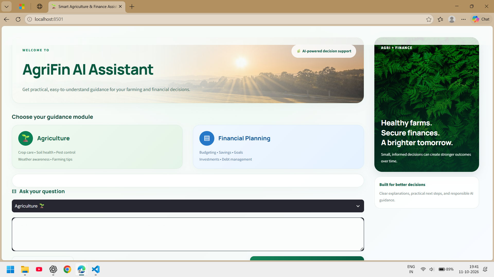
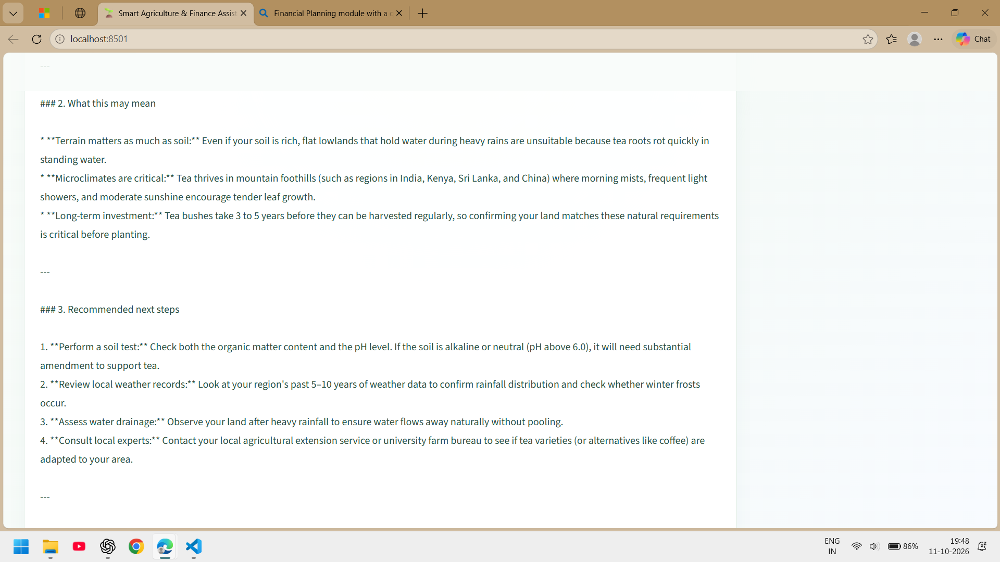
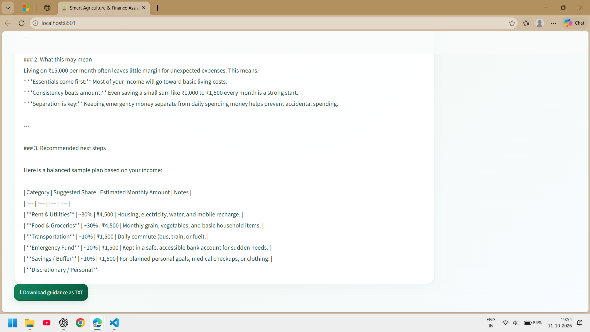

# AgriFin AI Assistant

### AI Smart Agriculture and Financial Decision Support Assistant

AgriFin AI Assistant is an AI-powered application developed using Python, Streamlit, and Google's Gemini API. It provides general agricultural guidance and basic financial planning assistance through an interactive web interface.

## Live Demo

**[Launch AgriFin AI Assistant](https://agri-fin-ai-assistant-esmyrbj5w5h8exvcabxs3x.streamlit.app/)**

The application is deployed using Streamlit Community Cloud.

## Project Overview

AgriFin AI Assistant explores the use of Generative AI to support agricultural and financial decision-making.

The application provides two primary modules:

- Agriculture Assistance: Provides AI-generated guidance for general agricultural questions.
- Financial Planning: Offers basic budgeting and financial planning guidance.

The application uses structured prompts to generate organized responses and provides an interactive interface for users.

## Key Features

- AI-powered agricultural assistance.
- Basic financial planning support.
- Google Gemini API integration.
- Structured AI-generated responses.
- Prompt engineering and response organization.
- Interactive Streamlit interface.
- Agriculture and finance module separation.
- Basic safety considerations and disclaimers.

## Technologies Used

| Technology | Purpose |
|---|---|
| Python | Application development |
| Streamlit | Web application interface |
| Google Gemini API | AI response generation |
| Google Gen AI SDK | Gemini integration |
| python-dotenv | Environment variable management |
| Git | Version control |
| GitHub | Source code hosting |
| Prompt Engineering | Structured AI interactions |

## Application Screenshots

### Home Page



### Agriculture Assistance





### Financial Planning




### Comparison Table


## Project Structure

```text
AI_Smart_Assistant/
│
├── app.py
├── requirements.txt
├── .gitignore
├── check_gemini.py
├── Final_Project_Report.md
├── prompt_outputs.txt
├── prompt_results.md
├── prompt_tests.py
├── test_prompts.py
│
├── experiments/
│   ├── README.md
│   └── prompt_experiments.md
│
└── screenshots/
    ├── _home.png
    ├── _agriculture1.png
    ├── _agriculture2.png
    ├── _agriculture3.png
    ├── _finance1.png
    ├── _finance2.png
    └── _comparison_table.png
```

## Installation and Setup

### Prerequisites

- Python 3.10 or later, compatible with project dependencies.
- pip
- Git
- Google Gemini API key

### 1. Clone the Repository

```bash
git clone https://github.com/Nikhil17-techie/agri-fin-ai-assistant.git
```

### 2. Navigate to the Project

```bash
cd agri-fin-ai-assistant
```

### 3. Install Dependencies

```bash
python -m pip install -r requirements.txt
```

### 4. Configure the API Key

Create a `.env` file in the project root directory.

Add:

```env
GEMINI_API_KEY=your_gemini_api_key_here
```

Replace the placeholder with your actual API key.

Never publish your API key or upload your `.env` file to GitHub.

### 5. Run the Application

```bash
python -m streamlit run app.py
```

Open the local URL displayed in your terminal.

## Testing and Prompt Experiments

The project includes supporting files for prompt testing and experimentation.

- `check_gemini.py` – Tests Gemini API connectivity.
- `test_prompts.py` – Contains prompt tests.
- `prompt_tests.py` – Additional prompt testing.
- `prompt_results.md` – Documents prompt testing results.
- `prompt_outputs.txt` – Stores example outputs.
- `experiments/` – Contains prompt engineering experiments.

## Limitations

- AI-generated information may be inaccurate or incomplete.
- Agricultural recommendations depend on crop type, location, soil, weather, and other conditions.
- Important agricultural decisions should be verified with qualified experts.
- Financial information is general guidance and is not a substitute for professional financial advice.
- Application functionality depends on internet connectivity, API availability, and usage limits.

## Future Improvements

- Support additional crops and agricultural scenarios.
- Improve question validation and response accuracy.
- Expand automated testing and response evaluation.
- Add regional language support.
- Improve user interface and accessibility.
- Introduce additional AI-powered decision-support capabilities.

## Author

**Sai Nikhil**

B.Tech Computer Science and Engineering  
Artificial Intelligence and Machine Learning

GitHub: https://github.com/Nikhil17-techie

Project Repository: https://github.com/Nikhil17-techie/agri-fin-ai-assistant

## Disclaimer

This project is developed for educational and demonstration purposes. It provides general agricultural and financial information and does not replace professional agricultural or financial advice.