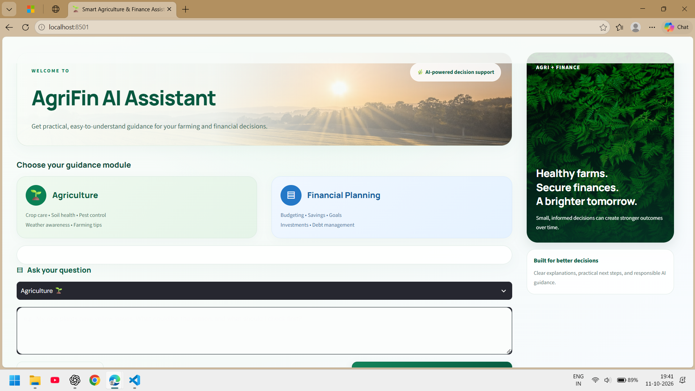
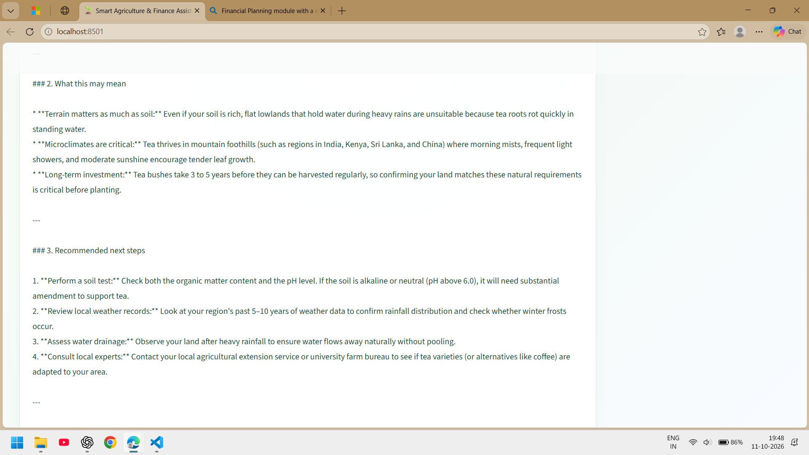
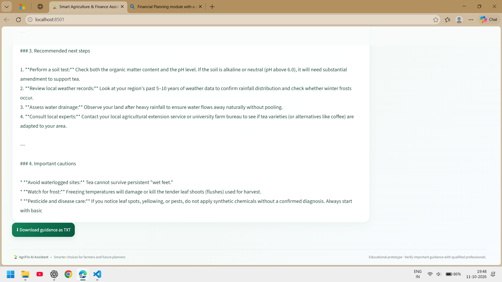
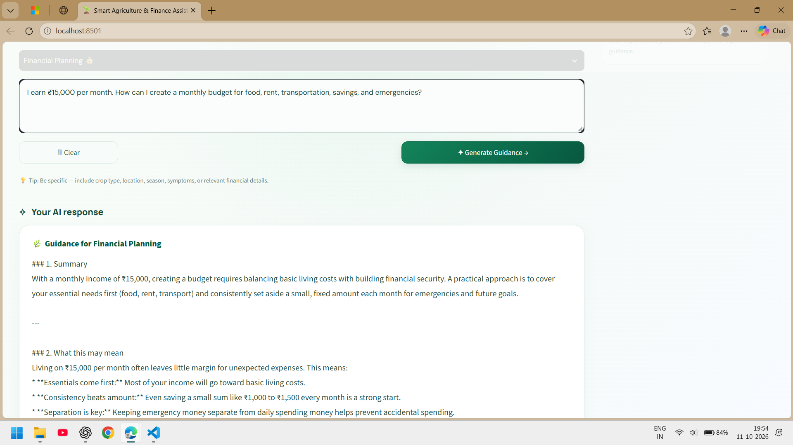
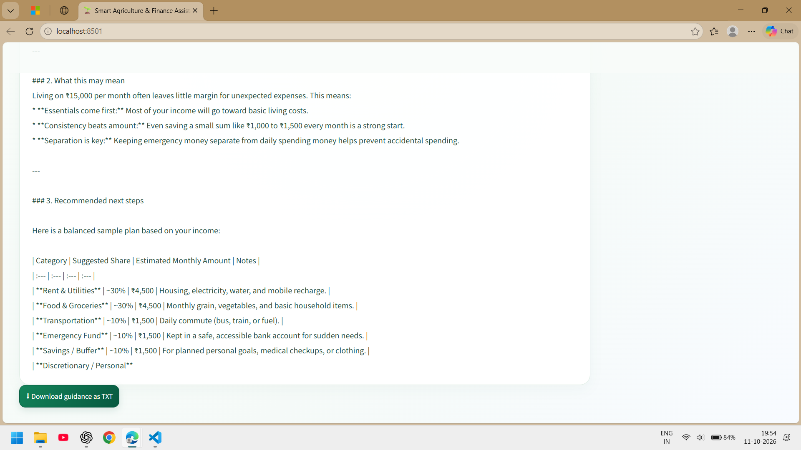
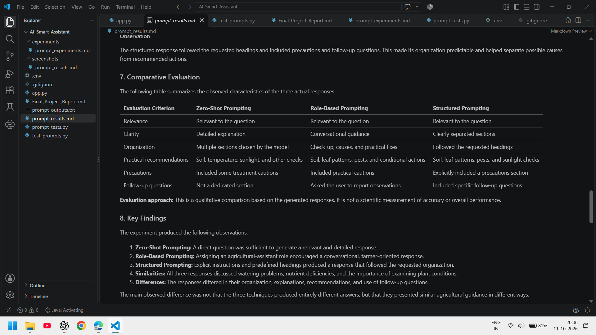

# AgriFin AI Assistant

## AI Smart Agriculture and Financial Decision Support Assistant

AgriFin AI Assistant is an AI-powered application developed using Python, Streamlit, and Google's Gemini API. It provides general agricultural guidance and basic financial planning assistance through an interactive web interface.

## Features

* Agriculture Assistance: Provides AI-generated guidance for general agricultural questions.
* Financial Planning: Offers general budgeting and financial planning guidance.
* Gemini AI Integration: Generates responses using Google's Gemini API.
* Prompt Engineering: Uses structured prompts to guide AI responses.
* Interactive Interface: Provides a user-friendly interface built with Streamlit.
* Structured Responses: Organizes AI-generated information into readable sections.
* Safety Considerations: Includes limitations and disclaimers for agricultural and financial guidance.

## Technologies Used

* Python
* Streamlit
* Google Gemini API
* Google Gen AI SDK
* python-dotenv
* Prompt Engineering
* Git and GitHub

## Project Structure

```text
AI_Smart_Assistant/
|
|-- app.py
|-- check_gemini.py
|-- requirements.txt
|-- .gitignore
|-- Final_Project_Report.md
|-- prompt_outputs.txt
|-- prompt_results.md
|-- prompt_tests.py
|-- test_prompts.py
|
|-- experiments/
|   |-- README.md
|   |-- prompt_experiments.md
|
|-- screenshots/
    |-- _home.png
    |-- _agriculture1.png
    |-- _agriculture2.png
    |-- _agriculture3.png
    |-- _finance1.png
    |-- _finance2.png
    |-- _comparison_table.png
```

## Application Screenshots

### Home Page



### Agriculture Module






### Financial Planning Module





### Comparison Table



## Installation and Setup

### Prerequisites

* Python 3.10 or later, subject to the dependencies used by the project
* pip
* Git
* A Google Gemini API key

### Step 1: Clone the Repository

```bash
git clone https://github.com/Nikhil17-techie/agri-fin-ai-assistant.git
```

### Step 2: Navigate to the Project Folder

```bash
cd agri-fin-ai-assistant
```

### Step 3: Install Dependencies

```bash
python -m pip install -r requirements.txt
```

### Step 4: Configure the API Key

Create a file named `.env` in the project root and add:

```env
GEMINI_API_KEY=your_gemini_api_key_here
```

Replace the placeholder with your actual Gemini API key.

Never upload your `.env` file or publish your API key.

### Step 5: Run the Application

```bash
python -m streamlit run app.py
```

Open the local URL displayed in the terminal. It is usually:

http://localhost:8501

## Testing and Prompt Experiments

The project includes scripts and documentation for testing prompts and exploring AI-generated responses.

* `check_gemini.py`: Tests Gemini API connectivity.
* `test_prompts.py`: Contains prompt tests.
* `prompt_tests.py`: Provides additional prompt testing.
* `prompt_results.md`: Documents prompt testing results.
* `prompt_outputs.txt`: Stores example outputs.
* `experiments/`: Contains prompt engineering experiments.

## Limitations

* AI-generated responses may be inaccurate or incomplete.
* Agricultural guidance depends on crop type, location, soil, weather, and other conditions.
* Important agricultural recommendations should be verified with qualified agricultural experts.
* Financial information is general guidance and is not a substitute for professional financial advice.
* Application functionality depends on internet connectivity, API availability, and usage limits.

## Future Improvements

* Support additional crops and agricultural scenarios.
* Improve question validation and response accuracy.
* Expand automated testing and response evaluation.
* Add support for regional languages.
* Improve the user interface and accessibility.

## Author

Sai Nikhil

B.Tech Computer Science and Engineering, Artificial Intelligence and Machine Learning

GitHub Profile: https://github.com/Nikhil17-techie

Project Repository: https://github.com/Nikhil17-techie/agri-fin-ai-assistant

## Disclaimer

This project is developed for educational and demonstration purposes. It provides general information and does not replace professional agricultural or financial advice.
